# মাত্র ১০০০ — Screens tasks (Canva + green-screen inserts)

For: **whoever owns screen workstreams 1 to 4** in `D:\Matro1000_Edit\output\tasks\Team_Plan_Finish_The_Film.md` (suggested: Persons A, B, C and D). Check against `D:\Matro1000_Edit\output\rough_cut_v2.mp4`. Its top-left label shows the shot number and timecode (hours:minutes:seconds:frames, 25 frames per second, same clock as the label in the top-left corner).

**Rules for every screen**
- Invented names only. No real bank, wallet, police, government or brand logos.
- Bangla text goes in as PNG/SVG or Canva text, never generated by artificial intelligence, so the glyphs render correctly.
- Name each file by shot number (`5.1.mp4`, `8.5.mp4`, `4.2.png`) and upload it to **screens/**.
- Animated screens: export MP4 at the exact duration listed. Static screens: a PNG is enough.
- Same fictional careers site and palette in Scenes 4, 5 and 6. CV filename is always `Mehrin_CV.pdf`.
- Spec letters (A–I) refer to "UI SCREEN DESIGN SPECIFICATIONS" at the end of PART 2 in `Matro1000_FINAL_Package_3D.txt`.

---

## A. Canva full-screen graphics — 16:9, 1920x1080 (13 screens)

These replace the grey placeholder cards in the rough cut. Make each one the length in the "Length" column: 6.1 and 12.1 start during a 0.6 s fade from black, so slightly less of them is visible than they last.

| Shot | Rough-cut in → out | Length | Exact text / content | Notes |
|---|---|---|---|---|
| 5.1 | 00:01:01:07 → 00:01:04:07 | **3 s** | Full Name: Mehrin · Phone: 01XXXXXXXXX · Education: MBA · CV: Mehrin_CV.pdf | Spec D. Typing + cursor click. Fields: Full Name / Phone / Education: MBA / Upload CV |
| 5.2 | 00:01:04:07 → 00:01:07:07 | **3 s** | Uploading Mehrin_CV.pdf — 10% → 35% | Progress bar animates 10% to 35%. Same layout as 5.1 |
| 5.7 | 00:01:17:07 → 00:01:20:07 | **3 s** | 100% — ✓ CV Uploaded Successfully | Same page as 5.2, progress at 100% |
| 6.1 | 00:01:23:00 → 00:01:25:17 | **3 s** | APPLICATION PROCESSING FEE — ৳1,000 — PAY NOW | Spec E. Comes up from the 5.7 success page. Never show a completed payment |
| 10.1 | 00:02:47:19 → 00:02:50:19 | **3 s** | How to report cybercrime in Bangladesh | Spec H. Search box, typed one key at a time |
| 10.2 | 00:02:50:19 → 00:02:53:19 | **3 s** | Bangladesh Police Online GD — gd.police.gov.bd · Police Cyber Support for Women — cybersupport.women@police.gov.bd | Search results. Mock UI, not a screenshot of the real site |
| 10.3 | 00:02:53:19 → 00:02:57:19 | **4 s** | EVIDENCE · call-log.png · message-screenshot.png · fake-job-page.png · suspicious-url.txt | Files dragged into a folder named EVIDENCE |
| 10.4 | 00:02:57:19 → 00:03:00:19 | **3 s** | Complaint details · Supporting evidence attached · SUBMIT | Simple stylised form, clearly an illustration |
| 10.5 | 00:03:00:19 → 00:03:02:19 | **2 s** | Cursor clicks SUBMIT → REPORT SUBMITTED | Overlay holds one beat, then hard cut. **Not** "Case solved" or "Suspect arrested" |
| 12.1 | 00:03:07:12 → 00:03:10:04 | **3 s** | “আপনার কাছে মাত্র ১,০০০ টাকা।” | Black screen, large high-contrast Bangla |
| 12.2 | 00:03:10:04 → 00:03:13:04 | **3 s** | “তার কাছে হাজার মানুষের ১,০০০ টাকা।” | Black screen, one highlighted sentence |
| 12.3 | 00:03:13:04 → 00:03:16:04 | **3 s** | যাচাই করুন। প্রমাণ রাখুন। রিপোর্ট করুন। — small line below: PCSW: cybersupport.women@police.gov.bd | No police logo. No 4-line checklist |
| 12.4 | 00:03:16:04 → 00:03:18:04 | **2 s** | মাত্র ১০০০ | Title card, no logo. Film ends exactly at 03:27 |

---

## B. Green-screen inserts

Phone screens: **9:16, 1080x1920**. Laptop and monitor screens: **16:9, 1920x1080**. The editor chroma-keys them in and corner-pins them to the screen's angle. Each PNG is a frame from the rough cut showing that angle.

### 2.3 — Incoming call (phone 9:16) · 00:00:16:10 → 00:00:18:10 · **2 s**
**Text:** Unknown Number · Incoming call · green answer button. No real phone number.
The phone lies flat on the desk, seen at a low angle. The editor shakes it slightly.
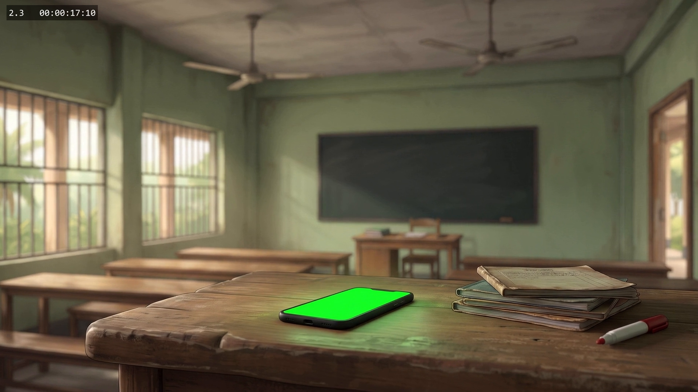

### 2.4 — Unknown Number / green answer icon · 00:00:18:10 → 00:00:20:10 · **2 s**
**No insert needed for the current footage.** The phone is already at his ear, so no screen is visible. Reuse the 2.3 design if the shot is ever regenerated.
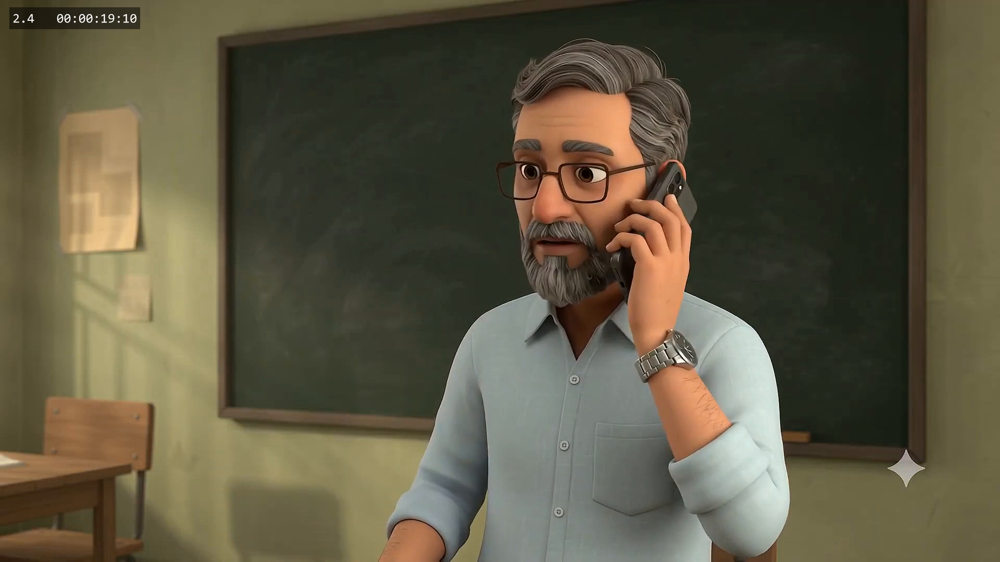

### 3.6 — Message from Unknown (phone 9:16) · 00:00:46:07 → 00:00:48:07 · **2 s**
**Text:** Message from Unknown: “স্যার, আবেদন করার লিংকটা পাঠালাম।” + link `jobs.example.invalid`
⚠️ **No green screen in the footage:** in G6 the phone never shows its screen. Make the graphic anyway. The editor will show it as a phone pop-up overlay, or cut it in as a full-frame phone close-up.
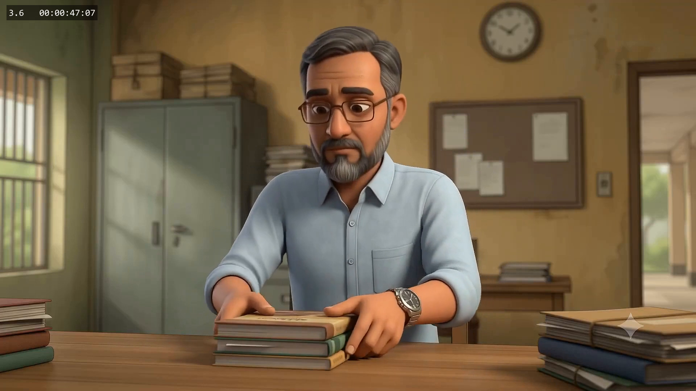

### 3.7 — Forward to Mehrin (phone 9:16) · 00:00:48:07 → 00:00:50:07 · **2 s**
**Text:** To Mehrin: “আমার এক পুরনো ছাত্রী চাকরির খবর দিয়েছে। দেখো, তোমার কাজে লাগে কি না।” + link preview. His thumb taps send.
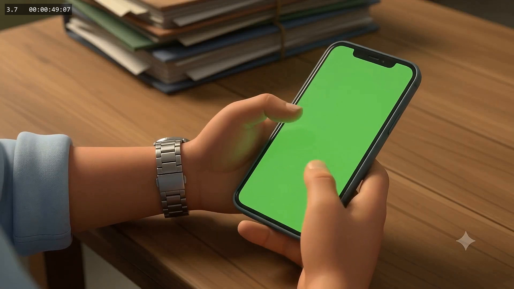

### 4.1 — Career Search page (laptop 16:9) · 00:00:50:07 → 00:00:54:07 · **4 s**
**Text (spec C):** header **Career Search**, three simple cards: Management Trainee / HR Executive / Junior Business Associate. Light off-white browser page, fictional content.
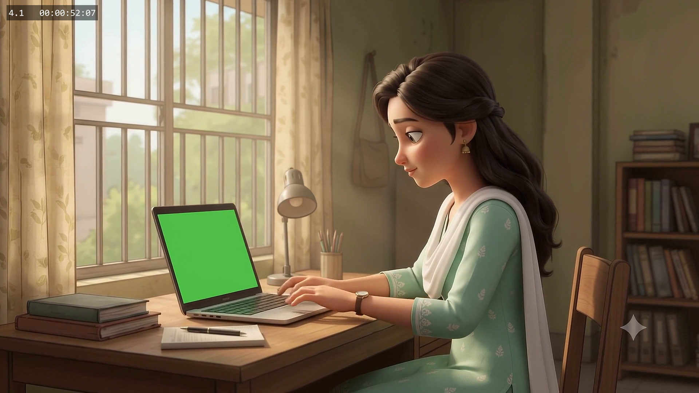

### 4.2 — Chat from Baba (phone 9:16) · 00:00:54:07 → 00:00:57:07 · **3 s**
**Text (spec B):** From **Baba**, single message: “আমার এক পুরনো ছাত্রী চাকরির খবর দিয়েছে। দেখো, তোমার কাজে লাগে কি না।” + a separate job-link preview. No real number.
The screen faces the camera only for about the first 0.5 s, as she lifts the phone.
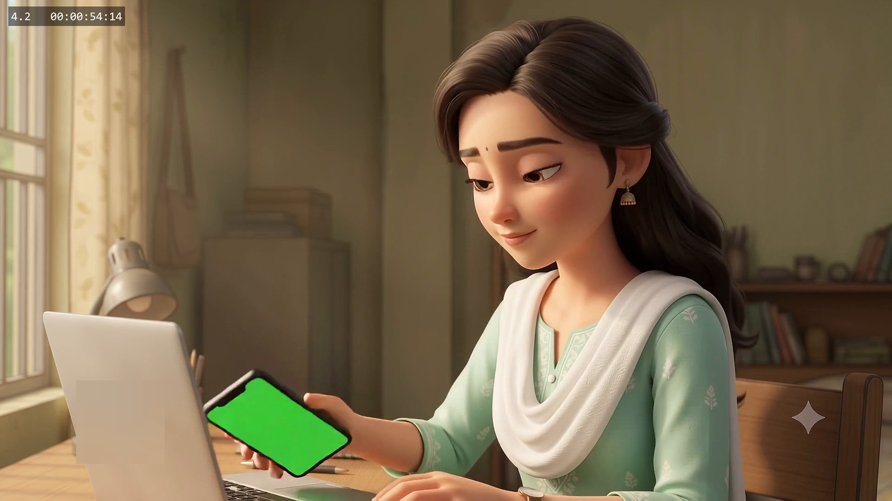

### 4.3 — Job Application page (laptop 16:9) + phone on desk (9:16) · 00:00:57:07 → 00:01:01:07 · **4 s**
**Text:** Job Application — Junior Executive — Apply Now (brief loading state first). Not a real company site.
The phone on the desk is also green: reuse the 4.2 Baba chat, dimmed.
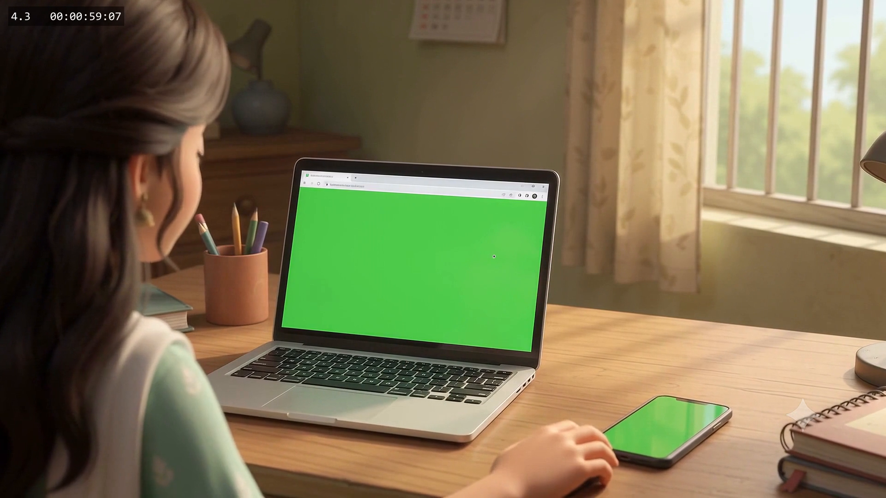

### 6.2 — Fee page (laptop 16:9) · 00:01:25:17 → 00:01:28:17 · **3 s**
**Text (spec E):** APPLICATION PROCESSING FEE • ৳1,000 • PAY NOW. Same design as Canva 6.1.
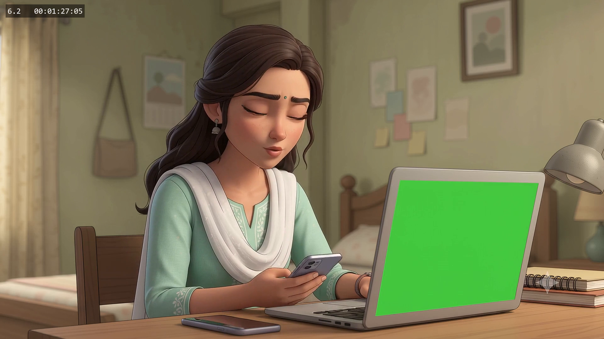

### 6.3 — Fee page (laptop 16:9) + Baba Calling (phone 9:16) · 00:01:28:17 → 00:01:30:23 · **2.24 s**
**Laptop:** same fee page. The cursor in the footage hovers at the **centre of the screen**, so put the **PAY NOW** button there. It must never be clicked.
**Phone:** **Baba Calling**. ⚠️ The phone screen in the footage is **black, not green**, and starts vibrating at about 00:01:29:21. The editor will corner-pin and track the graphic onto it.
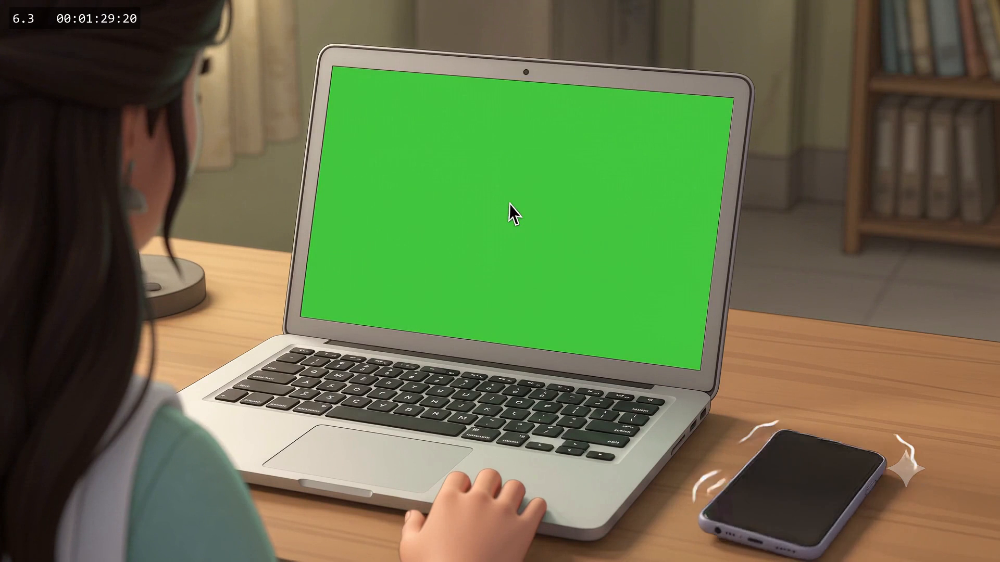

### 6.4 — Fee page (laptop 16:9) · 00:01:30:23 → 00:01:32:23 · **2 s**  *(not on the notebook list)*
Same fee page, still open while she answers the phone.
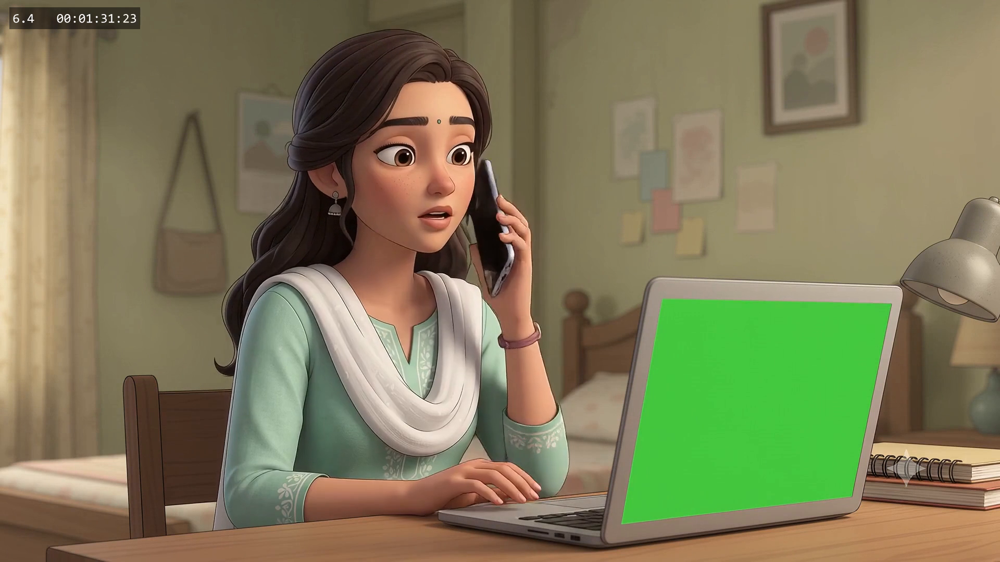

### 7.1 — Blurred fee page (laptop 16:9) · 00:01:32:23 → 00:01:38:23 · **6 s**
**Content:** the fee page, blurred. The editor can blur the 6.2 file, so no extra design is needed if 6.2 exists.
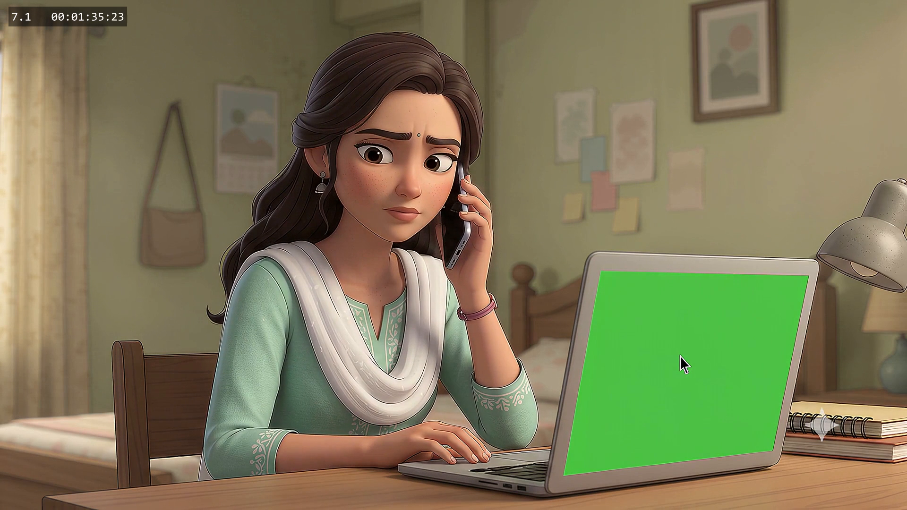

### 7.2 (end), 7.4 (start), 7.5 (start) — Blurred fee page (laptop 16:9)  *(not on the notebook list)*
Same blurred fee page as 7.1, on these extra laptop shots:
- **7.2:** 00:01:42:23 → 00:01:44:23 (2 s). Cut to Mehrin listening on the phone.
- **7.4:** 00:01:48:24 → 00:01:50:24 (2 s). Mehrin: “তুমি তো বললে তোমার ছাত্রী!”
- **7.5:** 00:01:53:24 → about 00:01:54:24, until the lid closes.

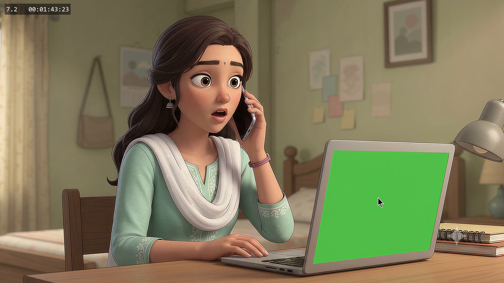
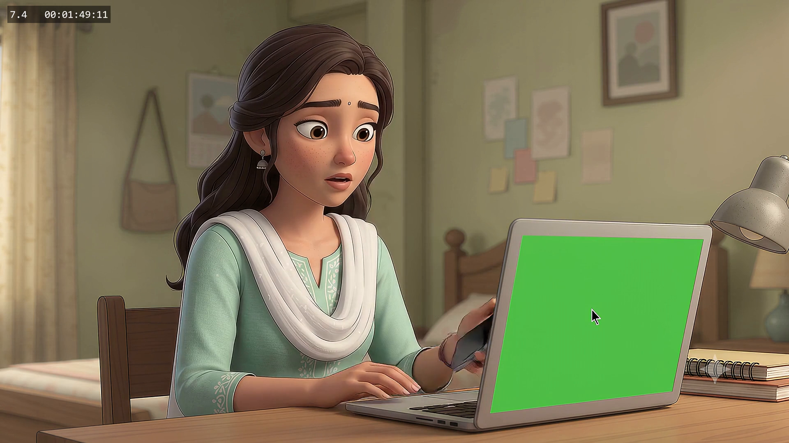
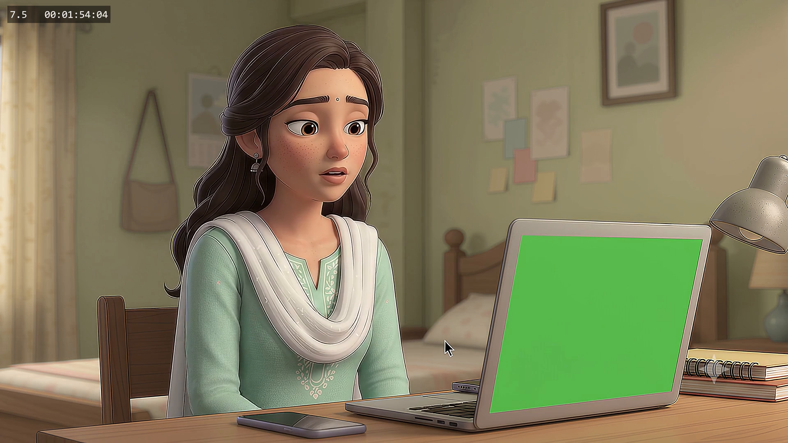

### 8.3 — Voice conversion waveform (monitor 16:9) · 00:02:03:09 → 00:02:07:09 · **4 s**
**Text:** VOICE CONVERSION — waveform only, no brand. After the mouse click, the waveform changes shape (male to female). An audio-editor screen recording works. No real software logo.
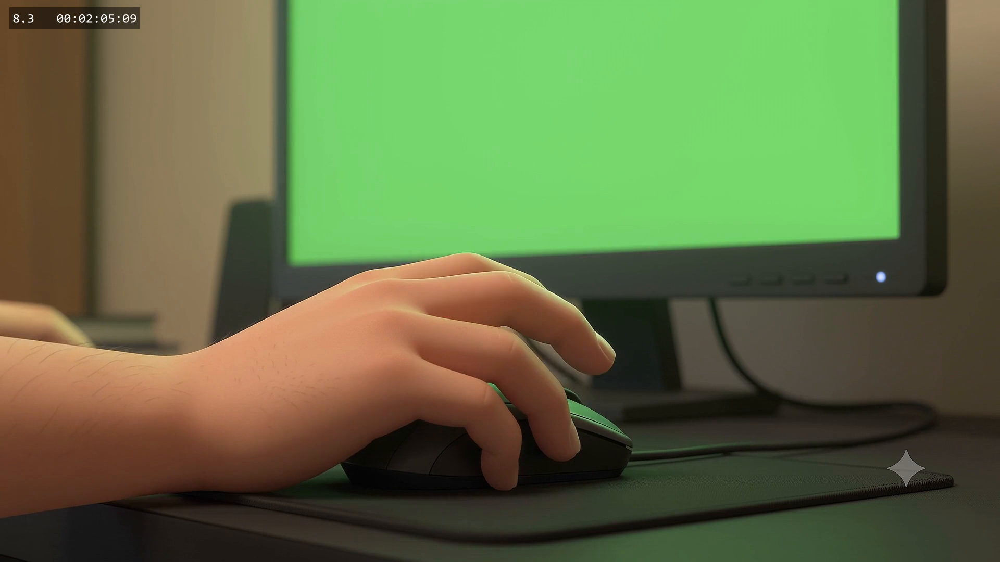

### 8.4 — Four scam windows (monitor 16:9) · 00:02:07:09 → 00:02:10:09 · **3 s**
**Text (spec F):** split tiles **FAKE JOB / LOAN APPLICATION / SCHOLARSHIP / TRAVEL BOOKING**. Generic window titles, no hacker clichés. This shot is a still, so the editor adds a slow push-in.
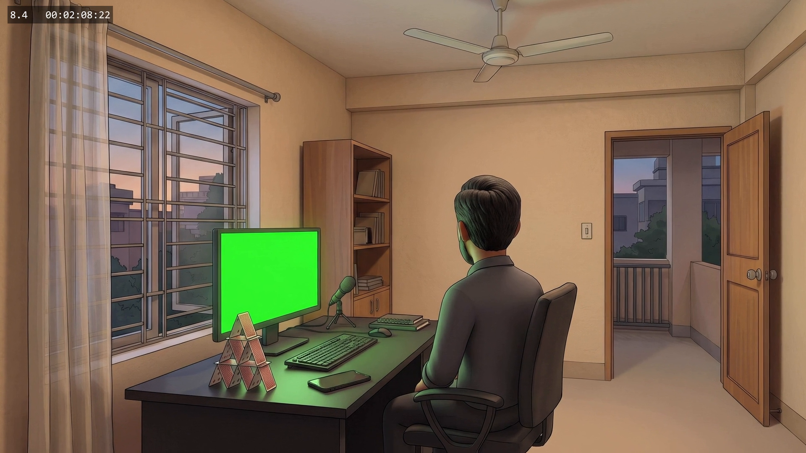

### 8.5 — Fictional wallet (phone 9:16) · 00:02:10:09 → 00:02:16:09 · **6 s** · ANIMATED (MP4)
**Text (spec G):** app title **Account Overview**, label **Available Balance**:

| Rough-cut time | Notification | Balance |
|---|---|---|
| 00:02:10:09 | — | ৳12,400 |
| 00:02:11:02 (TING 1) | Incoming ৳500 | ৳12,900 |
| 00:02:12:22 (TING 2) | Incoming ৳1,000 | ৳13,900 |
| 00:02:14:17 (TING 3) | Incoming ৳800 | ৳14,700 (hold readable to 00:02:16:09) |

The amounts must add up. No real wallet brand. This is other victims' money, never Mehrin's.
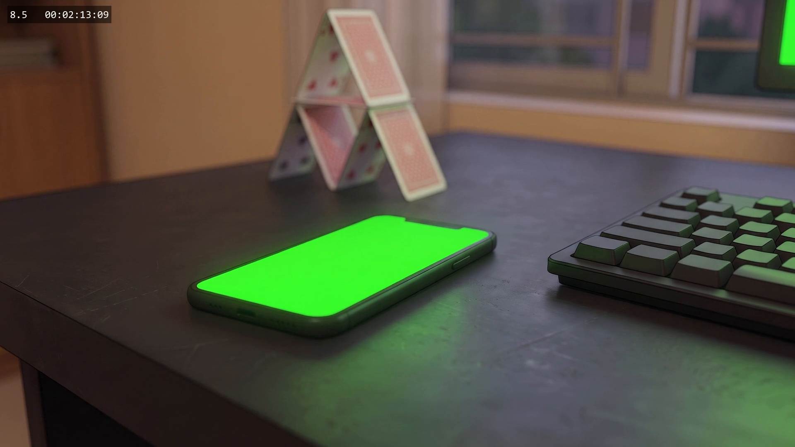

---

## C. Other text overlays (editor, not green screen)

These are also missing from the rough cut. A PNG with a transparent background is the easiest hand-off.

| Shot | Rough-cut time | Exact text | Notes |
|---|---|---|---|
| 1.1 | 00:00:00:00 → 00:00:02:00 | (optional) invented college sign | No real school name |
| 2.1–2.2 | 00:00:10:18 → 00:00:16:10 | DIGITAL HYGIENE (top) · VERIFY FIRST (large, middle) · Unknown Links • Fake Offers (small, bottom) | Spec A. White chalk on the green-black board. VERIFY FIRST is wiped away by the duster in 2.2, in sync with the phone ring |
| 3.5 | 00:00:42:07 → 00:00:46:07 | রেজিস্টার কক্ষ | Covers the garbled generated door sign of the records room |
| 7.3 | 00:01:44:23 → 00:01:48:24 | ২০১৮ · বি সেকশন | Over the register pages |
| 9.2 | 00:02:31:19 → 00:02:39:19 | টাকা যায়নি / মানুষ হাসবে / এত ঝামেলা / অভিযোগ করে কী হবে? | Floating phrases around Mehrin |
| 8.9–8.10 | 00:02:22:09 → 00:02:28:02 | Ghost overlay: scam windows (8.4), wallet balance (8.5), montage faces (5.3–5.6) | 20–30% opacity, with faint tings |
| 5.8 | 00:01:20:07 → 00:01:23:00 | (optional) Unknown Number | The colleague's phone screen isn't visible in G7, so only possible as a pop-up |
